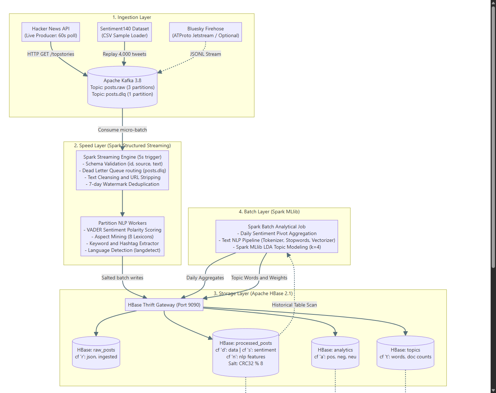
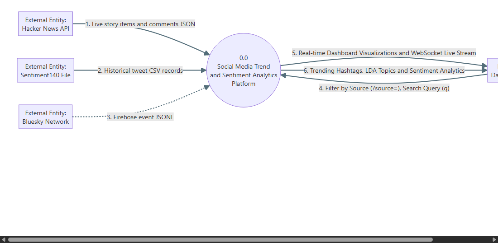
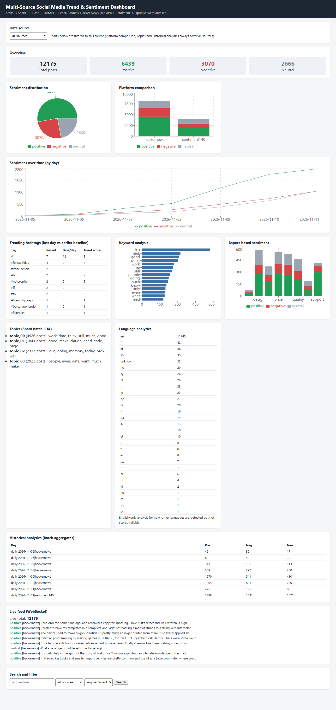
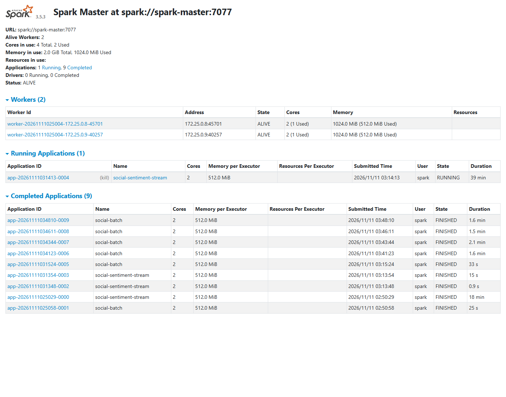
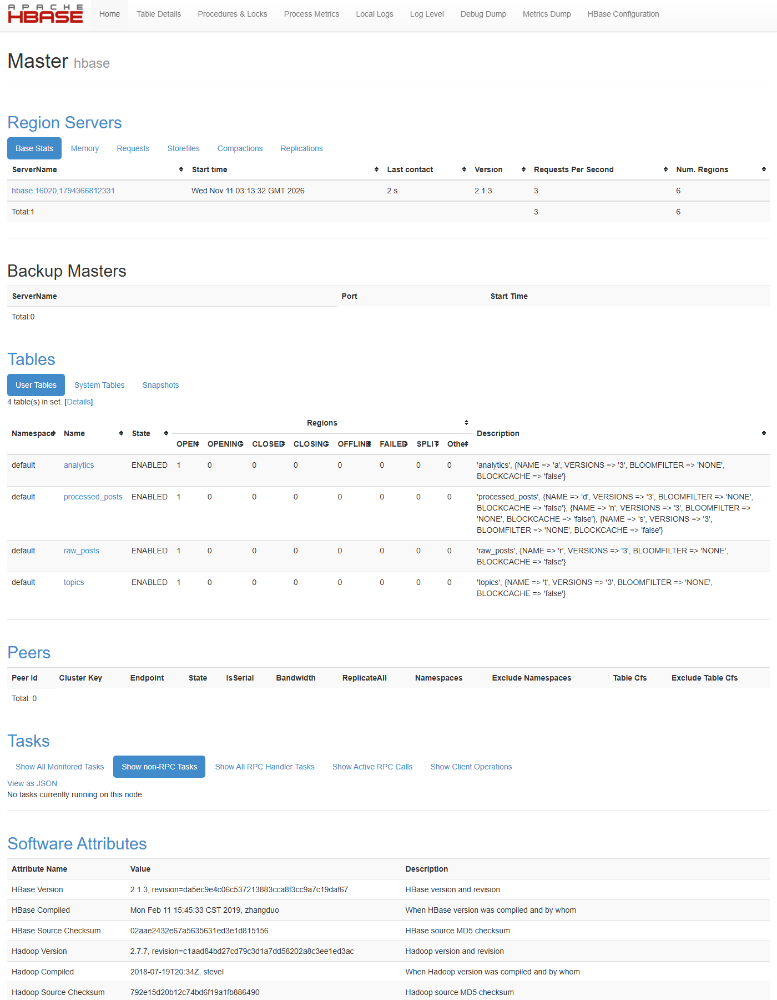
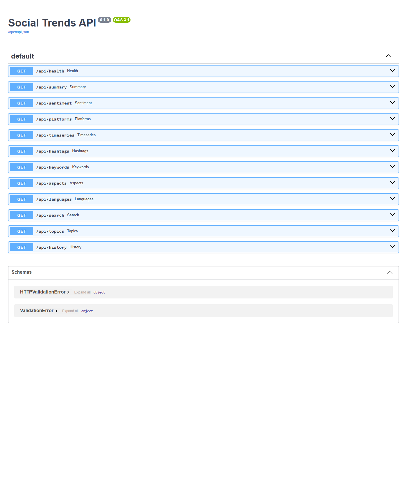

# Social Media Trend and Sentiment Analysis

## Team Members

| S.No. | Student Name | Roll Number | Role / Contribution |
|:-----:|:-------------|:------------|:--------------------|
| 1 | Abhishek Kumar | 231210003 | Data Ingestion & Kafka Pipeline |
| 2 | Aditya Narayan Tripathi | 231210003 | Spark Streaming & NLP Processing |
| 3 | Harshit Sharma | 231210047 | HBase Storage, API & Frontend Dashboard |

---

University big data project. It collects posts from Hacker News and a public Twitter dataset, pushes them through Kafka, processes them with Spark, stores them in HBase and shows the results on a React dashboard.

Stack: Apache Kafka 3.8, Apache Spark 3.5.3 (Structured Streaming and batch), Apache HBase 2.1, FastAPI, React. Everything runs in Docker on one laptop.

## Architecture & Data Flow

> [!NOTE]
> For in-depth diagrams (DFD Level 0, Level 1, Level 2 pipelines, Docker container topology, and HBase data model), see **[docs/ARCHITECTURE_AND_DFD.md](docs/ARCHITECTURE_AND_DFD.md)**. All diagrams are available in high-resolution PNG and vector SVG inside [`docs/diagrams/`](docs/diagrams/).

### System Architecture (Lambda Pattern)



### Context Diagram (DFD Level 0)



The Spark cluster is three containers: `spark-master`, `spark-worker-1` and `spark-worker-2`. Kafka, HBase, the streaming job, the backend and the frontend each have their own container too, so `docker compose ps` lists nine.

Since it all runs on one machine, the three Spark nodes share the same CPU, RAM and disk. It shows how the pieces connect, but it isn't a real cluster and says nothing about scaling or fault tolerance.

## Running it

You need Docker Desktop with the WSL2 backend. From this folder:

```
docker compose up -d --build
docker compose ps
```

The first build takes several minutes. Give it a minute or so after startup before the dashboard fills in.

- Dashboard: http://localhost:3000
- Spark UI: http://localhost:8080
- HBase UI: http://localhost:16010
- API docs: http://localhost:8000/docs

The topics and historical tables on the dashboard come from the batch job, so run it once:

```
docker compose run --rm --no-deps spark-stream sh -c '/opt/spark/bin/spark-submit --master spark://spark-master:7077 --conf spark.driver.host=$(hostname -i) --conf spark.driver.bindAddress=0.0.0.0 --conf spark.cores.max=2 --executor-memory 512m --driver-memory 512m /opt/app/batch_job.py'
```

To load more Hacker News data:

```
docker run --rm -e HN_MAX_ITEMS=8000 -e HN_COMMENTS_PER_STORY=40 --network social-trends_lab -v "${PWD}/dataset:/work" social-trends-producer python -u /work/load_hackernews.py
```

`docker compose down` stops everything and keeps the data. Add `-v` to wipe the data as well.

If the dashboard stays empty or the API returns errors, HBase may have stopped (this happened to me once). `docker compose restart hbase` fixed it, then restart `spark-stream` and `backend`.

## Data

There are two sources.

Hacker News comes from the public API, which needs no key. A small producer streams the current top stories every minute, and `dataset/load_hackernews.py` bulk-loads recent stories and their comments. That's about 8,000 posts.

Sentiment140 is a public Twitter dataset with labelled tweets. I sampled 4,000 of them (2,000 positive, 2,000 negative) and replayed them through Kafka. The tweets are from 2009, so I used the time of ingestion as the event time. Otherwise the 7-day watermark in the streaming job would treat them as late data.

An earlier version also had generated sample posts. I removed them (`dataset/remove_source.py` deleted their rows), so everything on the dashboard is real data.

## Screenshots

Dashboard, with all sources selected. The dropdown at the top filters most charts to one source.



Spark master UI, with both workers alive and the streaming application running.



HBase master UI, with the four tables.



The backend API docs.



## What each part does

**Producer** (`producer/producer.py`) creates the Kafka topics and sends Hacker News posts as JSON. It also sends two malformed messages on purpose so the dead-letter topic has something in it.

**Kafka**: `posts.raw` has 3 partitions and the message key is the source name. `posts.dlq` has 1. There's only one broker, so replication factor is 1.

**Streaming job** (`spark/app/stream_job.py`) reads `posts.raw` every 5 seconds. For each record it:
- checks that id, source and text exist (failures go to `posts.dlq`);
- cleans the text, strips URLs, and drops duplicates (using a 7-day watermark to keep state small);
- works out sentiment, hashtags, keywords, aspect sentiment and language;
- writes the raw and processed records to HBase.

The NLP is in `spark/app/nlp.py`. Sentiment uses VADER, a ready-made lexicon model for English, with a compound score of 0.05 or above as positive and -0.05 or below as negative. Aspects are found by matching keywords like "price" or "battery" and scoring the sentence they appear in. Language detection uses langdetect.

**Batch job** (`spark/app/batch_job.py`) reads everything from `processed_posts`, counts sentiment per day and source, and fits LDA (Spark MLlib, 4 topics) for topic modelling. The last run used 12,006 records.

**HBase tables**

| Table | Families | Row key | Written by |
|---|---|---|---|
| `raw_posts` | `r` | salt, source, id | streaming |
| `processed_posts` | `d` (data), `s` (sentiment), `n` (hashtags, keywords, aspects) | same | streaming |
| `topics` | `t` | `topic_NN` | batch |
| `analytics` | `a` | `daily`, date, source | batch |

Row keys start with a salt (crc32 of source and id, mod 8) so writes spread across keys instead of piling up. Values are stored as UTF-8 strings or JSON. Spark writes through HBase's Thrift gateway with happybase. HBase runs as the standalone image, so there is no separate HDFS.

**Backend** (`backend/main.py`) is the only thing that reads HBase. It scans the processed table and aggregates in Python, which is fine for ten thousand rows but wouldn't scale. Endpoints: `/api/summary`, `/sentiment`, `/platforms`, `/timeseries`, `/hashtags`, `/keywords`, `/aspects`, `/languages`, `/search`, `/topics`, `/history`, plus a WebSocket at `/ws/live` for the live feed. Most of them accept `?source=` to filter.

**Frontend** (`frontend/src/App.jsx`) is a single React page using Recharts. It calls the API only and never touches HBase.

Trending hashtags compare the last day of data against the average daily count from before that. It's a simple ratio, not a proper trend model.

## Testing on Sentiment140

To check the sentiment model I compared its output with the dataset's labels. `dataset/evaluate.py` reads the predicted label for each of the 4,000 tweets back out of HBase and compares it with the original.

| | |
|---|---|
| Accuracy, counting neutral predictions as wrong | 0.533 |
| Accuracy on the 2,929 non-neutral predictions | 0.728 |
| Predicted neutral | 1,071 of 4,000 |
| Positive: precision, recall, F1 | 0.666, 0.632, 0.649 |
| Negative: precision, recall, F1 | 0.842, 0.434, 0.573 |
| Macro F1 | 0.611 |

Confusion matrix (rows are the dataset's label, columns are the prediction):

| | positive | negative | neutral |
|---|---|---|---|
| positive | 1,265 | 163 | 572 |
| negative | 633 | 868 | 499 |

Sentiment140 only has positive and negative tweets, so every neutral prediction counts as a miss. The model is weak on negative tweets (recall 0.43), and many short informal tweets end up neutral. Nothing was trained here, since VADER is used as it comes. Training a classifier on the labelled tweets would probably help, but I haven't done it, so I can't say by how much. This was one run on one sample.

## Limitations

- English only. Language detection runs but the other languages are not scored, and it mislabels a lot of short tweets (the language table on the dashboard shows this).
- Accuracy was only checked on Sentiment140. Aspect sentiment, topics and trends were not evaluated. The LDA topics are fairly vague word groups ("work, time, think, still").
- Hacker News and Sentiment140 are very different kinds of text, so the combined charts mix two things.
- One Kafka broker and one HBase node, so no fault tolerance. I did not run performance, load or recovery tests.
- HBase stopped responding once during testing and a restart fixed it. I didn't find the cause.
- The batch job opens a new HBase connection after LDA finishes, because the old one was closed by the server while training ran.
- Version choices (Spark 3.5.3 with matching Kafka connector jars, HBase 2.1 image) were picked so they work together here. I didn't check them against every official compatibility table.

## Folder layout

```
docker-compose.yml
producer/        Kafka producer for live Hacker News
spark/           Dockerfile and app/ (stream_job.py, batch_job.py, nlp.py, hb.py)
backend/         FastAPI app
frontend/        React app (built and served by nginx)
dataset/         loaders, Sentiment140 sample and evaluation, Bluesky scripts
docs/            detailed architecture & DFD specs, screenshots
docs/ARCHITECTURE_AND_DFD.md  full architecture and DFD Level 0, 1, 2 diagrams
DEMO.md          demo script
```
