# System Architecture and Data Flow Diagrams (DFD)

This document provides a comprehensive technical reference for the **Social Media Trend and Sentiment Analysis** platform. It details the system architecture, Lambda architecture pattern, container topology, database schema, and Data Flow Diagrams (DFD Level 0, Level 1, and Level 2) reflecting the codebase implementation.

---

## Table of Contents
1. [End-to-End System Architecture Diagram](#1-end-to-end-system-architecture-diagram)
2. [Docker Container & Deployment Topology](#2-docker-container--deployment-topology)
3. [HBase NoSQL Storage Schema](#3-hbase-nosql-storage-schema)
4. [Data Flow Diagrams (DFD)](#4-data-flow-diagrams-dfd)
   - [DFD Level 0: Context Diagram](#dfd-level-0-context-diagram)
   - [DFD Level 1: System Decomposition](#dfd-level-1-system-decomposition)
   - [DFD Level 2: Stream & Batch Processing Pipelines](#dfd-level-2-stream--batch-processing-pipelines)
   - [DFD Level 2.1: Streaming Ingestion & Real-Time NLP Pipeline](#dfd-level-21-streaming-ingestion--real-time-nlp-pipeline)
   - [DFD Level 2.2: Offline Batch Processing & Topic Modeling (LDA)](#dfd-level-22-offline-batch-processing--topic-modeling-lda)
   - [DFD Level 2.3: API Serving & WebSocket Delivery](#dfd-level-23-api-serving--websocket-delivery)
5. [Component Reference & Source Code Map](#5-component-reference--source-code-map)

---
      

## 1. End-to-End System Architecture Diagram

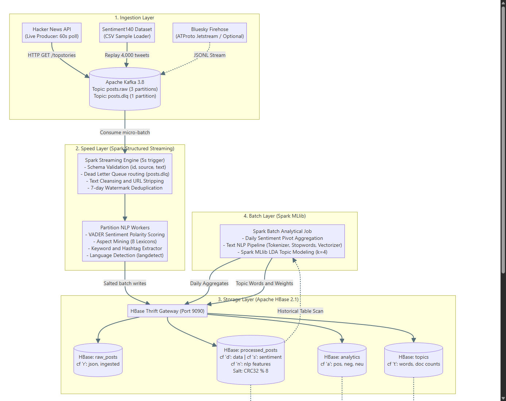

> Direct Vector Image: [architecture-system.svg](diagrams/architecture-system.svg) | High-Resolution Raster: [architecture-system.png](diagrams/architecture-system.png)

<details>
<summary><b>Click to expand Mermaid Source Code</b></summary>

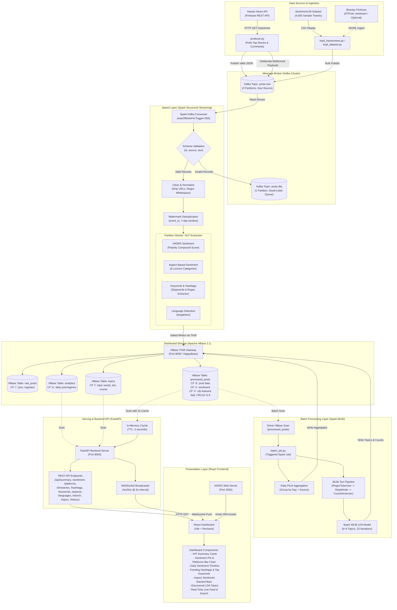

</details>

---

## 2. Docker Container & Deployment Topology

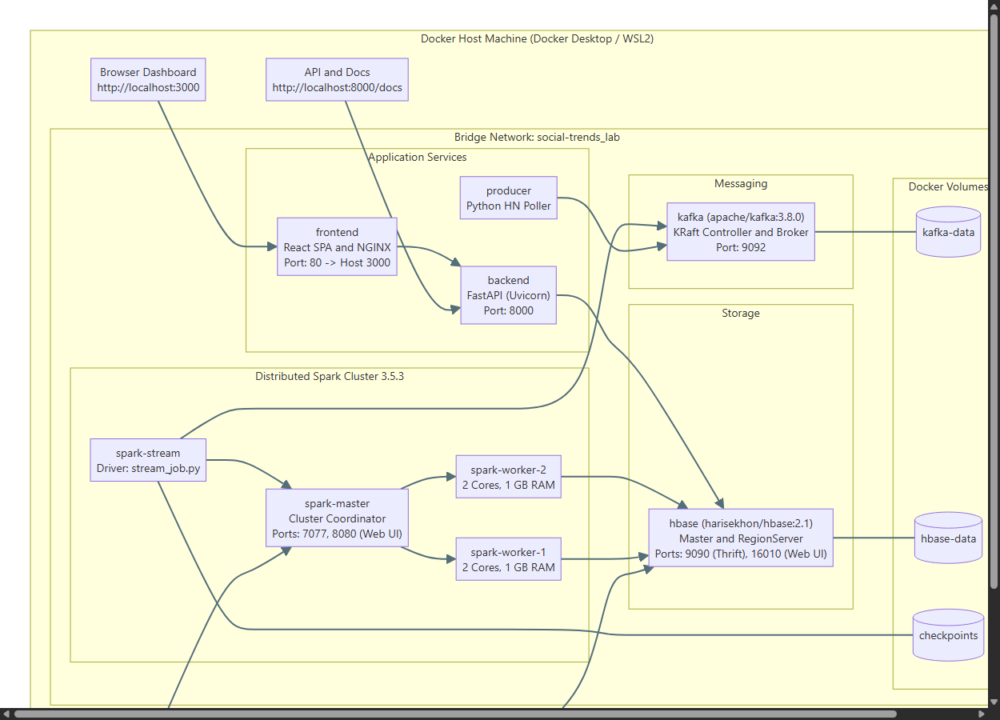

> Direct Vector Image: [deployment-topology.svg](diagrams/deployment-topology.svg) | High-Resolution Raster: [deployment-topology.png](diagrams/deployment-topology.png)

All 9 services execute within a private Docker bridge network (`social-trends_lab`). The multi-node Spark cluster consists of a standalone master and two worker nodes sharing local host resources.

<details>
<summary><b>Click to expand Mermaid Source Code</b></summary>

```mermaid
graph TB
    subgraph HOST ["Local Host / Laptop (Docker Desktop with WSL2)"]
        subgraph DOCKER_NET ["Docker Network: lab (Bridge: social-trends_lab)"]
            
            subgraph KAFKA_CONTAINER ["Kafka Service"]
                C_KAFKA["kafka (apache/kafka:3.8.0)\nKRaft Mode (Node 1)\nPort: 9092 (Internal)"]
            end

            subgraph HBASE_CONTAINER ["HBase Service"]
                C_HBASE["hbase (harisekhon/hbase:2.1)\nStandalone Master & RegionServer\nPorts: 9090 (Thrift), 16010 (Web UI)"]
            end

            subgraph SPARK_CLUSTER ["Distributed Spark Cluster (3.5.3)"]
                C_SPARK_M["spark-master\nMaster Process\nPorts: 7077 (Cluster), 8080 (Web UI)"]
                C_SPARK_W1["spark-worker-1\n2 Cores, 1 GB RAM\nConnects to spark://spark-master:7077"]
                C_SPARK_W2["spark-worker-2\n2 Cores, 1 GB RAM\nConnects to spark://spark-master:7077"]
                C_SPARK_STR["spark-stream\nStreaming Driver Application\nstream_job.py"]
            end

            subgraph APP_CONTAINERS ["Application & Client Services"]
                C_PROD["producer\nPython Kafka Producer\nPolls Hacker News API"]
                C_BACK["backend\nFastAPI Application (Uvicorn)\nPort: 8000"]
                C_FRONT["frontend\nReact SPA + NGINX\nPort: 80 (Container) -> 3000 (Host)"]
            end

            subgraph VOLUMES ["Persistent Volumes"]
                V_KAFKA[("kafka-data\n(/var/lib/kafka/data)")]
                V_HBASE[("hbase-data\n(/hbase-data)")]
                V_CHECK[("checkpoints\n(/checkpoints)")]
            end
        end

        %% Host Port Mappings
        HOST_3000["Host: http://localhost:3000"] -->|HTTP| C_FRONT
        HOST_8000["Host: http://localhost:8000"] -->|REST / WebSocket| C_BACK
        HOST_8080["Host: http://localhost:8080"] -->|Web UI| C_SPARK_M
        HOST_16010["Host: http://localhost:16010"] -->|Web UI| C_HBASE

        %% Inter-container Connections
        C_PROD -->|posts.raw| C_KAFKA
        C_SPARK_STR -->|Consume| C_KAFKA
        C_SPARK_STR -->|Schedule Tasks| C_SPARK_M
        C_SPARK_M --> C_SPARK_W1
        C_SPARK_M --> C_SPARK_W2
        C_SPARK_W1 -->|Thrift Puts| C_HBASE
        C_SPARK_W2 -->|Thrift Puts| C_HBASE
        C_BACK -->|Thrift Scans (9090)| C_HBASE
        C_FRONT -->|API Proxy / Direct Calls| C_BACK

        %% Volume Attachments
        C_KAFKA --- V_KAFKA
        C_HBASE --- V_HBASE
        C_SPARK_STR --- V_CHECK
    end
```

</details>

---

## 3. HBase NoSQL Storage Schema

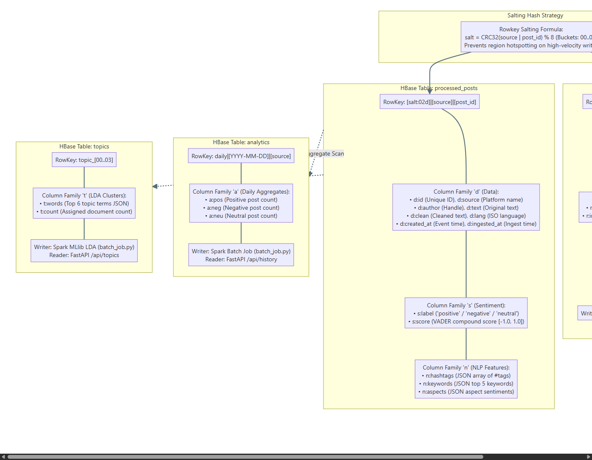

> Direct Vector Image: [hbase-nosql-schema.svg](diagrams/hbase-nosql-schema.svg) | High-Resolution Raster: [hbase-nosql-schema.png](diagrams/hbase-nosql-schema.png)

HBase acts as the central NoSQL datastore for both streaming writes and batch analytical workloads. Salted keys prevent write hotspots across HBase region boundaries.

<details>
<summary><b>Click to expand Mermaid Source Code</b></summary>

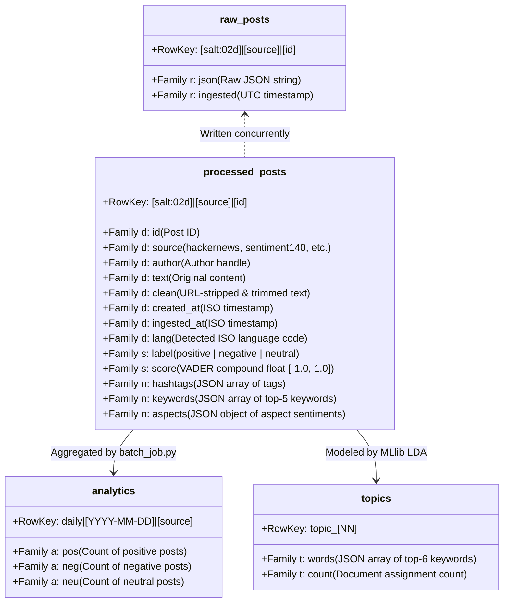

</details>

### Key Salting Formula
$$\text{salt} = \text{CRC32}(\text{source} \parallel "|" \parallel \text{post\_id}) \pmod 8$$
Row keys are formatted as `"{salt:02d}|{source}|{post_id}"` (e.g. `03|hackernews|hn-38491204`). This uniformly balances write traffic across 8 virtual key buckets.

---

## 4. Data Flow Diagrams (DFD)

### DFD Level 0: Context Diagram

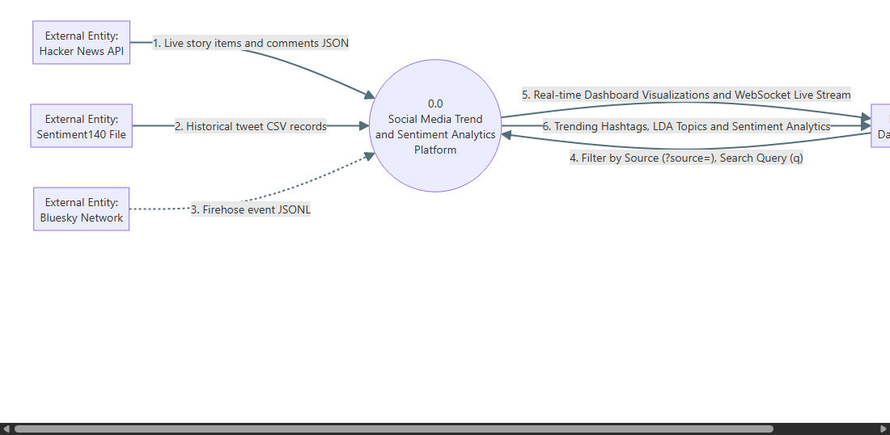

> Direct Vector Image: [dfd-level-0.svg](diagrams/dfd-level-0.svg) | High-Resolution Raster: [dfd-level-0.png](diagrams/dfd-level-0.png)

The Level 0 Context Diagram establishes the system boundary, showing all external actors and high-level inbound/outbound data flows.

<details>
<summary><b>Click to expand Mermaid Source Code</b></summary>

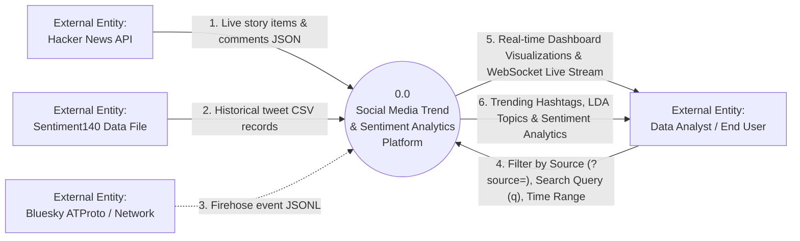

</details>

---

### DFD Level 1: System Decomposition

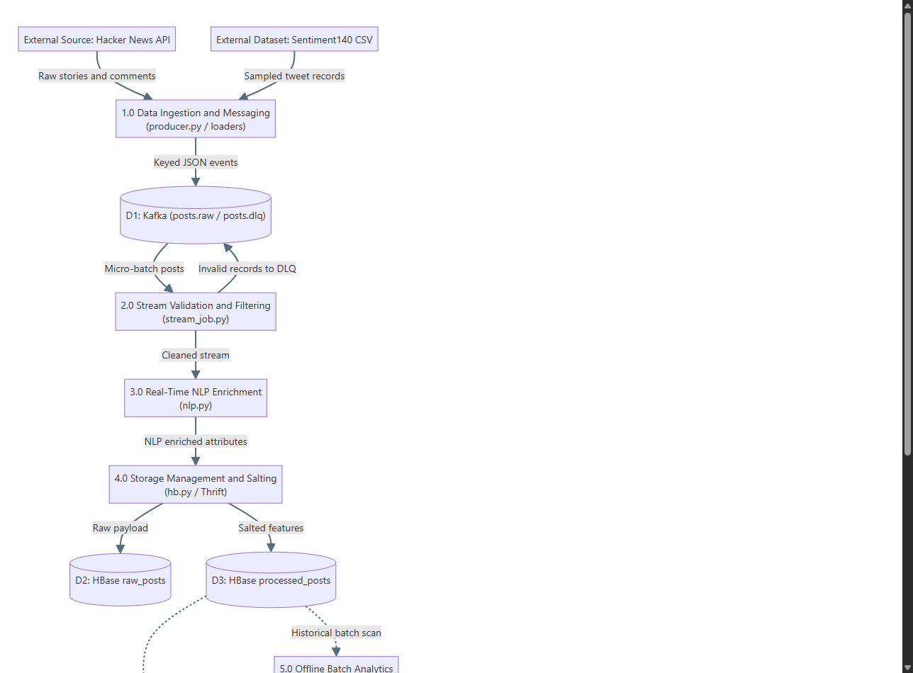

> Direct Vector Image: [dfd-level-1.svg](diagrams/dfd-level-1.svg) | High-Resolution Raster: [dfd-level-1.png](diagrams/dfd-level-1.png)

The Level 1 DFD decomposes the system into six primary functional processes and five physical data stores.

<details>
<summary><b>Click to expand Mermaid Source Code</b></summary>

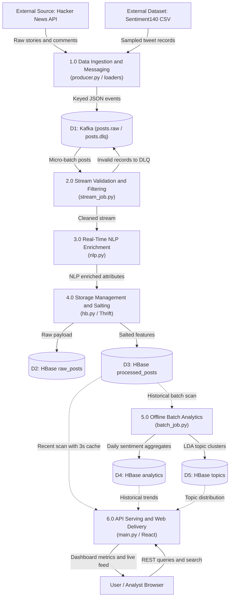

</details>

---

### DFD Level 2: Stream & Batch Processing Pipelines

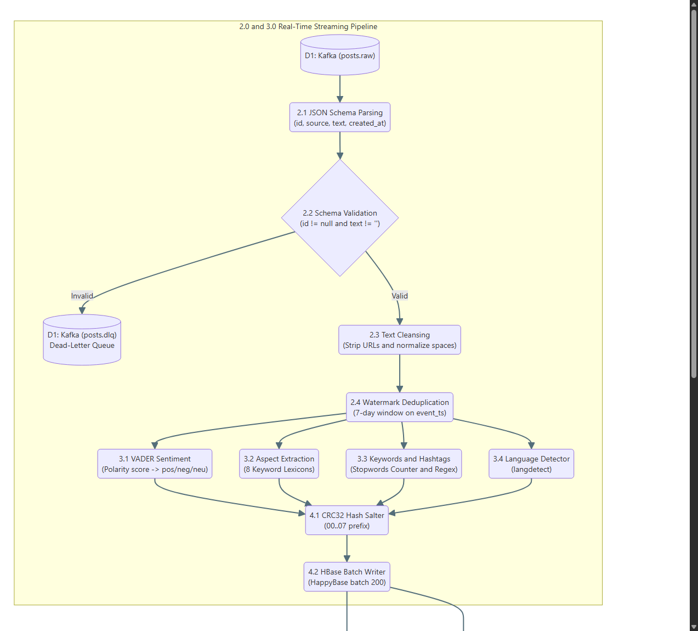

> Direct Vector Image: [dfd-level-2.svg](diagrams/dfd-level-2.svg) | High-Resolution Raster: [dfd-level-2.png](diagrams/dfd-level-2.png)

---

### DFD Level 2.1: Streaming Ingestion & Real-Time NLP Pipeline

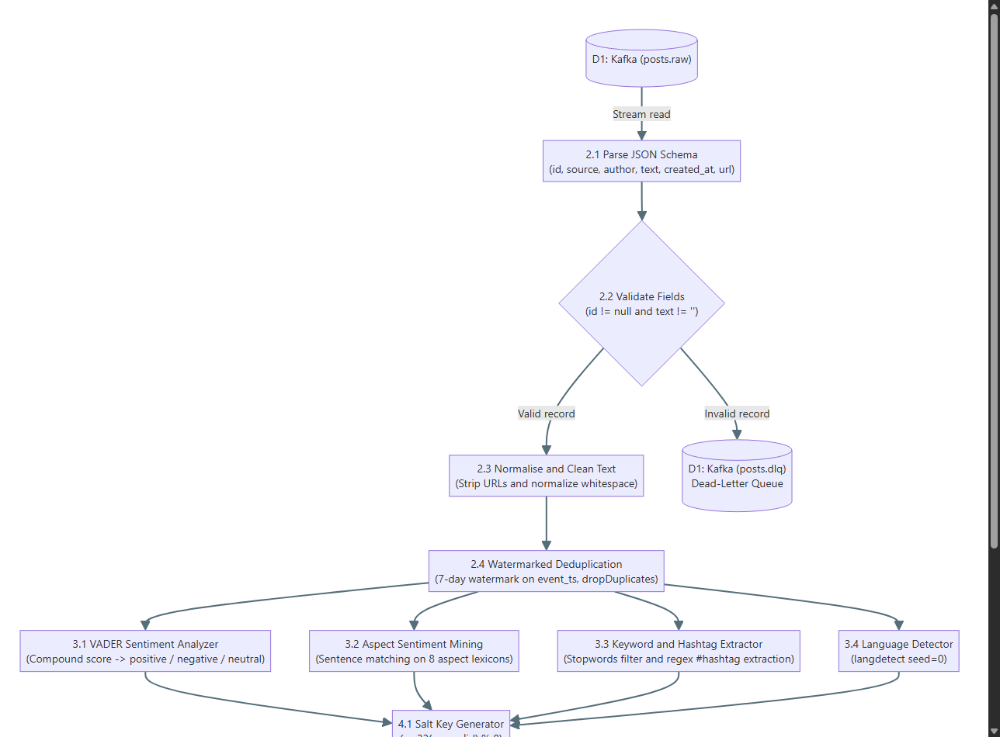

> Direct Vector Image: [dfd-level-2-1.svg](diagrams/dfd-level-2-1.svg) | High-Resolution Raster: [dfd-level-2-1.png](diagrams/dfd-level-2-1.png)

Decomposition of **Process 2.0 (Stream Validation & Filtering)** and **Process 3.0 (Real-Time NLP Enrichment)**.

<details>
<summary><b>Click to expand Mermaid Source Code</b></summary>

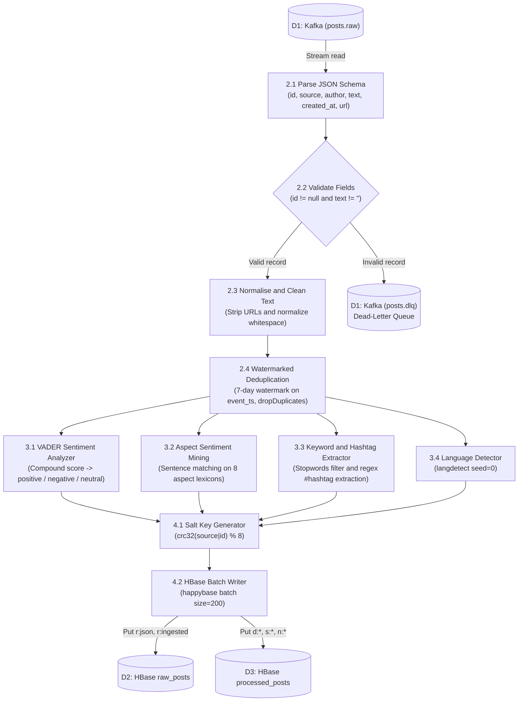

</details>

---

### DFD Level 2.2: Offline Batch Processing & Topic Modeling (LDA)

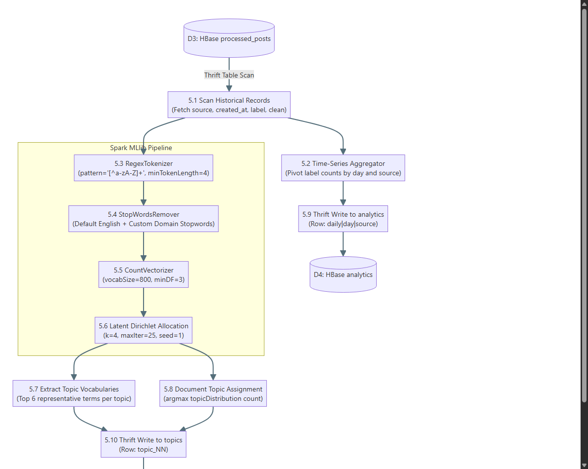

> Direct Vector Image: [dfd-level-2-2.svg](diagrams/dfd-level-2-2.svg) | High-Resolution Raster: [dfd-level-2-2.png](diagrams/dfd-level-2-2.png)

Decomposition of **Process 5.0 (Offline Batch Processing & Topic Modeling)**.

<details>
<summary><b>Click to expand Mermaid Source Code</b></summary>

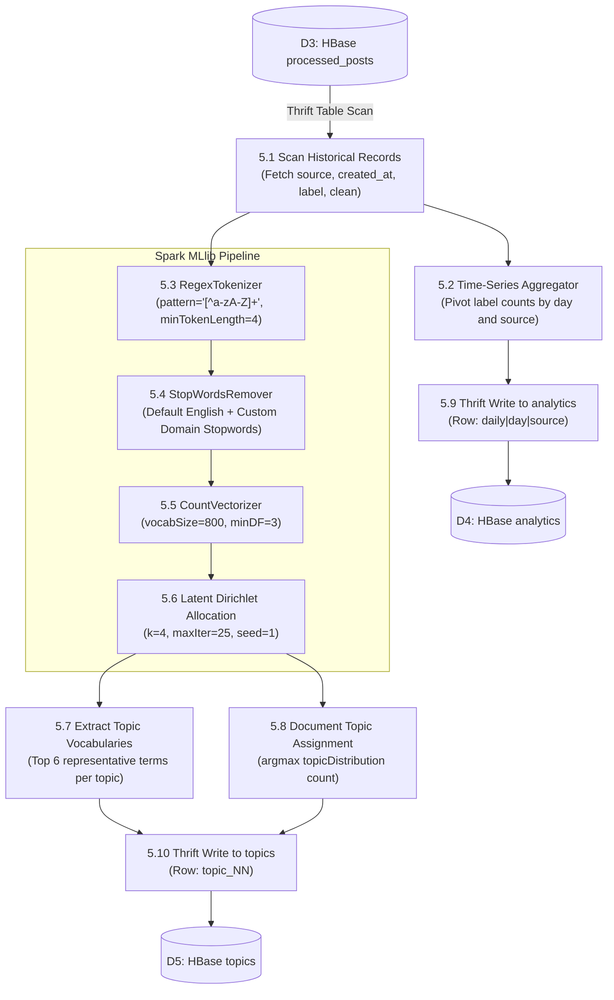

</details>

---

### DFD Level 2.3: API Serving & WebSocket Delivery

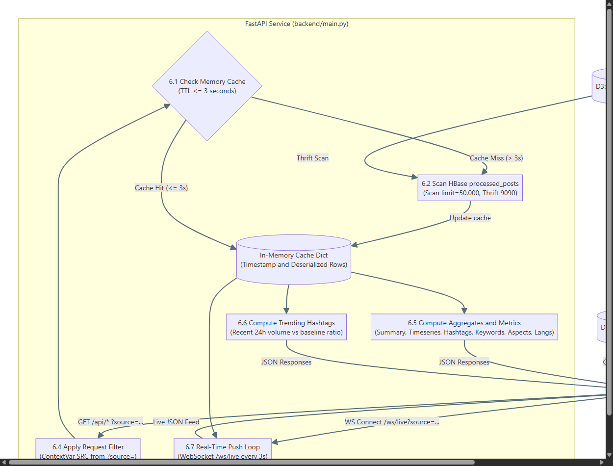

> Direct Vector Image: [dfd-level-2-3.svg](diagrams/dfd-level-2-3.svg) | High-Resolution Raster: [dfd-level-2-3.png](diagrams/dfd-level-2-3.png)

Decomposition of **Process 6.0 (API Serving & Web Delivery)**.

<details>
<summary><b>Click to expand Mermaid Source Code</b></summary>

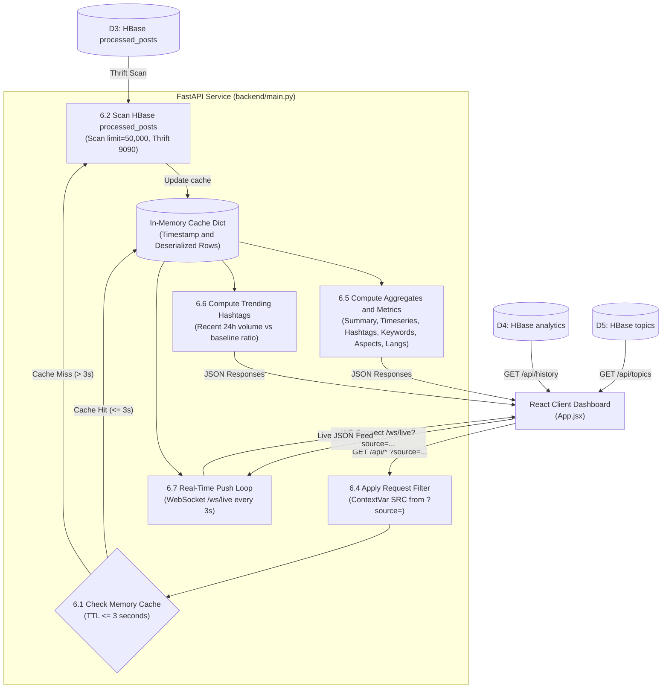

</details>

---

## 5. Component Reference & Source Code Map

| Layer | Component | File Path | Responsibilities & Technologies |
|---|---|---|---|
| **Ingestion** | Live Producer | [producer.py](file:///c:/Users/abhis/Downloads/bda/Big-Data-Analytics-Project/producer/producer.py) | Polls Hacker News Firebase API; injects DLQ test records; publishes to Kafka. |
| **Ingestion** | Dataset Loaders | [load_dataset.py](file:///c:/Users/abhis/Downloads/bda/Big-Data-Analytics-Project/dataset/load_dataset.py), [load_hackernews.py](file:///c:/Users/abhis/Downloads/bda/Big-Data-Analytics-Project/dataset/load_hackernews.py) | Ingests Sentiment140 CSV and bulk HN archives into `posts.raw`. |
| **Messaging** | Kafka Broker | [docker-compose.yml](file:///c:/Users/abhis/Downloads/bda/Big-Data-Analytics-Project/docker-compose.yml#L13-L30) | KRaft broker; manages partitioned `posts.raw` and `posts.dlq` topics. |
| **Speed** | Streaming Driver | [stream_job.py](file:///c:/Users/abhis/Downloads/bda/Big-Data-Analytics-Project/spark/app/stream_job.py) | Structured Streaming, schema verification, 7-day watermark, HBase partition writes. |
| **Speed** | NLP Utilities | [nlp.py](file:///c:/Users/abhis/Downloads/bda/Big-Data-Analytics-Project/spark/app/nlp.py) | VADER sentiment scoring, aspect extraction, hashtag/keyword parsing, `langdetect`. |
| **Storage** | HBase Helpers | [hb.py](file:///c:/Users/abhis/Downloads/bda/Big-Data-Analytics-Project/spark/app/hb.py) | HappyBase connection management, table initialization, CRC32 rowkey salting. |
| **Batch** | Batch Aggregator | [batch_job.py](file:///c:/Users/abhis/Downloads/bda/Big-Data-Analytics-Project/spark/app/batch_job.py) | Historical HBase scan, daily sentiment pivot aggregation, MLlib LDA topic clustering. |
| **Serving** | FastAPI Server | [main.py](file:///c:/Users/abhis/Downloads/bda/Big-Data-Analytics-Project/backend/main.py) | 3s caching layer, context-based filtering, REST endpoints, WebSocket `/ws/live`. |
| **UI** | React Dashboard | [App.jsx](file:///c:/Users/abhis/Downloads/bda/Big-Data-Analytics-Project/frontend/src/App.jsx) | Recharts data visualizations, platform filtering, search, and live event display. |
| **Evaluation**| Benchmark Script| [evaluate.py](file:///c:/Users/abhis/Downloads/bda/Big-Data-Analytics-Project/dataset/evaluate.py) | Validates VADER accuracy and precision/recall against Sentiment140 gold labels. |

